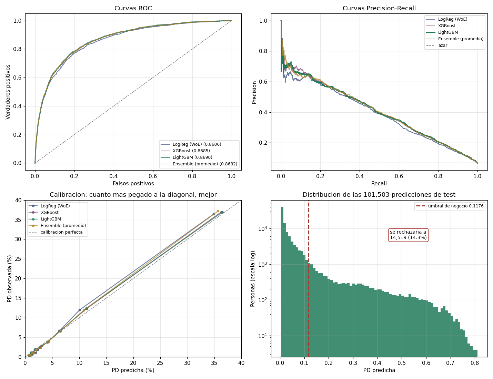

# Probability of Default: Give Me Some Credit

Modelo de probabilidad de default (PD) para crédito al consumo: estima la
probabilidad de que un cliente tenga un atraso de 90 días o más en los dos años
siguientes, la convierte en una decisión de aprobación con un umbral derivado
de la economía del préstamo y la explica con un scorecard.

Proyecto individual de investigación aplicada. No es un sistema listo para
producción bancaria: el dataset no tiene marca temporal y no permite validación
fuera de tiempo ni monitoreo (ver [Limitaciones](#limitaciones)).

## Datos

[Give Me Some Credit](https://www.kaggle.com/c/GiveMeSomeCredit) (Kaggle, 2011).

| Conjunto | Filas | Default | Uso |
|---|---|---|---|
| Entrenamiento | 120,000 | 6.68 % | ajuste, selección de variables e hiperparámetros |
| Validación | 30,000 | 6.68 % | evaluación final, umbral y valor económico |
| Test de Kaggle | 101,503 | sin etiqueta | solo submission |

Entrenamiento y validación salen de un único split estratificado (80/20,
semilla 42) de las 150,000 filas etiquetadas. Diez variables: utilización de
crédito revolvente, edad, tres conteos de atrasos, ratio de endeudamiento,
ingreso, líneas de crédito, créditos inmobiliarios y dependientes.

## Metodología

- **Limpieza por reglas, sin estado aprendido.** Los códigos de sistema 96/98 en
  los conteos de atraso, `RevolvingUtilization > 100` e ingresos ≤ 1 pasan a
  faltante con su indicador. Esos grupos tienen un riesgo opuesto al que sugiere
  su valor: 54.67 % de default en los centinelas frente al 6.68 % global.
- **Dos ramas sobre el mismo split.** Regresión logística sobre WoE (cortes
  fijos, tablas aprendidas solo con train) y boosters sobre los valores crudos,
  con `NaN` nativo.
- **Selección dentro de train.** Variables, hiperparámetros y número de árboles
  se eligen con subconjuntos de train.
- **Evaluación.** Validación cruzada de 5 folds con comparaciones pareadas e IC
  95 % corregido de Nadeau–Bengio; métricas de discriminación (AUC, KS, AP),
  calibración (error por deciles, Brier) y valor económico en validación.
- **Decisión.** Aprobar si PD < M/(M+L). Con margen M = $800 y pérdida
  L = $6,000 (LGD 60 % sobre $10,000), el umbral es 11.76 %.

## Modelos

| Modelo | Variables | Papel |
|---|---|---|
| Regresión logística (WoE) | 10 originales | Baseline interpretable; base del scorecard |
| XGBoost | 24 (originales, derivadas, indicadores) | Booster de referencia |
| **LightGBM** | 24 | Modelo elegido por la regla de selección |

## Resultados

| Modelo | AUC (CV) | KS | AP | Calibración | Brier | Valor |
|---|---|---|---|---|---|---|
| Regresión logística | 0.85794 ± 0.00359 | 0.5722 | 0.388 | 0.73 pp | 0.0499 | $173.21 |
| XGBoost | 0.86628 ± 0.00306 | 0.5832 | 0.406 | 0.35 pp | 0.0487 | $180.37 |
| **LightGBM** | **0.86619 ± 0.00343** | 0.5885 | 0.403 | 0.36 pp | 0.0487 | $182.21 |

**Muestra.** AUC: media ± desviación estándar (`ddof=0`) de 5 folds sobre las
150,000 filas etiquetadas. KS, AP, calibración (error absoluto medio por
deciles), Brier y valor (beneficio frente a no usar modelo, por solicitud): las
30,000 filas de validación. Fuente: `artifacts/metrics/`.

Diferencias de AUC emparejadas fold a fold (IC 95 %, Nadeau–Bengio):

```
XGBoost  - LogReg    +0.0083   [+0.0057, +0.0110]
LightGBM - LogReg    +0.0083   [+0.0060, +0.0105]
XGBoost  - LightGBM  +0.0001   [-0.0011, +0.0013]
```

Los boosters superan a la regresión logística. Entre XGBoost y LightGBM no se
detecta diferencia en ninguna métrica, lo que no demuestra que sean
equivalentes.



## Validación

- **Elección del modelo.** Regla fijada de antemano: entre los modelos con AUC
  medio de CV a menos de 0.002 del mejor, el de menor error de calibración. Se
  aplica sobre una CV 5×5 dentro de train, sin usar validación. Elige LightGBM
  (calibración 0.319 frente a 0.350 pp de XGBoost), pero **ninguna diferencia
  entre ambos es significativa** (AUC, calibración, Brier): la elección la
  decide la regla, no una superioridad demostrada
  ([detalle](docs/04_modelado.md#472-uso-de-validación-en-la-elección-del-modelo)).
- **CV anidada.** Repetir la selección de hiperparámetros dentro de cada fold da
  0.86647 frente a 0.86628 (IC de la diferencia [-0.0008, +0.0012]): no se
  detecta optimismo por la selección.
- **Ablaciones.** Quitar el bloque de variables de atraso cuesta 0.058 de AUC.
  Sus miembros son sustituibles entre sí, así que la importancia por variable no
  es interpretable. En la logística, `MonthlyIncome` y `OpenCreditLines` pueden
  quitarse sin pérdida medible, pero se mantienen las 10 variables.
- **Coherencia del scorecard.** Los 10 coeficientes tienen el signo esperado y el
  VIF máximo es 1.3.

Experimentos completos en [docs/05_experimentos.md](docs/05_experimentos.md).

## Evaluación económica

Sobre las 30,000 solicitudes de validación, aprobar con LightGBM al umbral de
11.76 % da $15,832,400 frente a $10,366,000 de aprobar a todos: **+$5.47M**
($182.21 por solicitud). El valor depende del coste del default: con una
pérdida de la mitad del margen el modelo aporta $8,000; a partir de ~15× separa
un negocio que pierde dinero de uno que gana
([detalle](docs/06_negocio_y_regulacion.md)).

## Interpretabilidad

- **Scorecard** (regresión logística): 600 puntos = odds 50:1, 20 puntos
  duplican las odds; el umbral de negocio equivale a 545 puntos. La suma de
  puntos reproduce exactamente el score del modelo.
- **SHAP** (LightGBM): explicación por cliente que suma exactamente la
  predicción. `RevolvingUtilization` concentra el 33.8 % del impacto medio. La
  importancia nativa no es fiable con variables redundantes: en XGBoost la
  misma variable recibe el 30.5 % del SHAP y solo el 4.3 % del gain (E9).

## Estructura

```
01_eda.py … 08_scorecard.py   pipeline en orden (03b: interpretabilidad de la logística)
predict.py                    puntuar solicitantes nuevos con el modelo final
src/                          limpieza, WoE, métricas y persistencia (con tests)
tests/                        110 pruebas
experiments/                  ablaciones, CV anidada, selección sin validación
artifacts/metrics/            métricas publicadas (versionadas)
artifacts/plots/, outputs/    gráficas de evaluación y del EDA
docs/                         documentación técnica (10 capítulos)
```

## Reproducción

Probado con Python 3.13.9; versiones fijadas en `requirements.txt`.

```bash
python -m venv .venv && source .venv/bin/activate    # Windows: .venv\Scripts\activate
pip install -r requirements.txt
```

Los datos de Kaggle no se pueden redistribuir: descarga `cs-training.csv`,
`cs-test.csv` y `sampleEntry.csv` de la
[competición](https://www.kaggle.com/c/GiveMeSomeCredit/data) y colócalos en
`data/` (o indica otra carpeta con `PD_DATA_DIR`).

```bash
python 01_eda.py && python 02_preprocessing.py && python 03_train_logistic.py
python 03b_logistic_interpretabilidad.py && python 04_train_xgboost.py
python 05_train_lightgbm.py && python 06_evaluation.py
python 07_business_evaluation.py && python 08_scorecard.py      # ~2 min en total

python predict.py --demo
pytest tests/ -v
```

Desde un entorno limpio, la cadena regenera idénticos los datasets, las métricas
y las submissions publicadas. Los experimentos de `experiments/` son opcionales
y tienen su propio README.

## Limitaciones

- **Sin validación fuera de tiempo ni monitoreo.** El dataset no tiene fechas;
  la validación es sobre particiones aleatorias de la misma población.
- **Ventana del conteo de atrasos de 90+ días.** El diccionario no la declara. Se
  descarta la contaminación directa con el target (el 65 % de los morosos no
  tenía ningún atraso previo de 90+), pero no un solapamiento parcial.
- **Reject inference.** Solo se observa a quien recibió crédito.
- **Economía simplificada.** Importe uniforme, sin valor temporal del dinero ni
  recuperaciones parciales.
- **Validación no es completamente independiente.** Se eligió el modelo sin
  ella, pero sus resultados se examinaron durante el desarrollo (comparaciones
  y una regla de selección anterior que la usaba).
- **Target.** Atraso de 90+ días en 24 meses; no coincide con la definición
  regulatoria completa de default ni con el horizonte de 12 meses de la PD de
  capital.

## Documentación

| Capítulo | Contenido |
|---|---|
| [01 Arquitectura](docs/01_arquitectura.md) | Estructura, dependencias entre scripts, artefactos |
| [02 Fundamentos](docs/02_fundamentos_matematicos.md) | WoE, IV, regresión logística, boosting, métricas, scorecard |
| [03 Pipeline de datos](docs/03_pipeline_datos.md) | Limpieza, códigos de sistema, prevención de fuga |
| [04 Modelado](docs/04_modelado.md) | Selección, hiperparámetros, comparación y elección del modelo |
| [05 Experimentos](docs/05_experimentos.md) | Registro de experimentos (E1–E19) |
| [06 Negocio y regulación](docs/06_negocio_y_regulacion.md) | Valor económico, umbrales, ECL, Basilea, equidad |
| [07 Revisión técnica](docs/07_auditoria.md) | Revisión interna: hallazgos, impacto y corrección |
| [08–10](docs/README.md) | Comparación metodológica, guía de desarrollo, referencias |

## Licencia

Código bajo licencia [MIT](LICENSE). Los datos de Kaggle no se incluyen y
están sujetos a las reglas de la competición.
