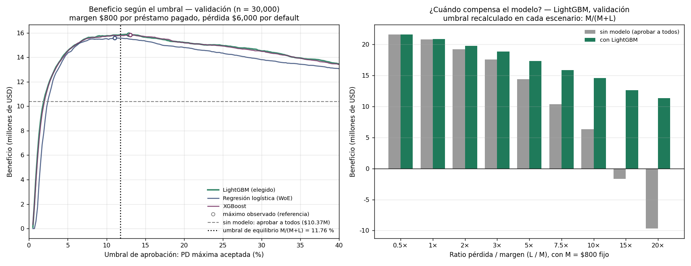
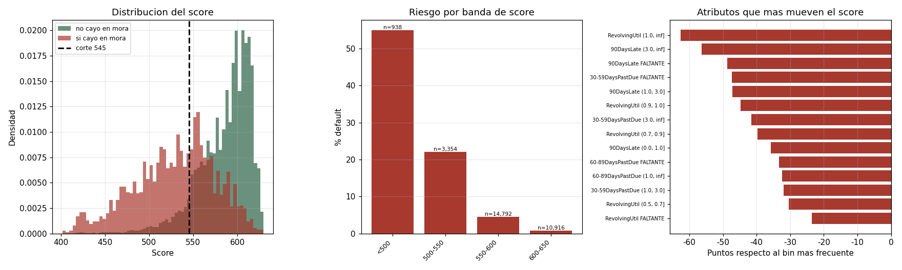

# 06 — Impacto de negocio e implicaciones regulatorias

[← Experimentos](05_experimentos.md) · [Índice](README.md) · [Siguiente: Revisión técnica →](07_auditoria.md)

---

> **Advertencia de alcance.** Este capítulo aplica marcos regulatorios
> (Basilea II/III, IFRS 9) al modelo construido. La descripción de los marcos es
> **[TEORÍA]** con fuente citada; su aplicación concreta a este proyecto es
> **[RECOM]** del autor de la documentación y **no constituye asesoramiento
> regulatorio**. Un despliegue real requiere validación por la función de
> Riesgos y aprobación supervisora.

---

## 6.1 El marco económico

### 6.1.1 Supuestos

**[IMPL]** Definidos en `07_business_evaluation.py`:

| Parámetro | Valor | Significado |
|---|---|---|
| `PRESTAMO` | $10,000 | Importe medio (EAD aproximada) |
| `MARGEN` | $800 | Ganancia si el cliente paga (8% sobre el principal) |
| `LGD` | 0.60 | *Loss Given Default* |
| `PERDIDA` | $6,000 | $= \text{PRESTAMO} \times \text{LGD}$ |

**Ratio pérdida/ganancia:** $L/M = 7.5$.

**[RECOM]** Un LGD del 60% es plausible para crédito al consumo no garantizado.
Los estudios de la industria sitúan el LGD de tarjetas de crédito entre 60% y
90% según jurisdicción y agresividad de recobro. El valor es conservador-medio.

### 6.1.2 La regla de decisión

$$p^{\ast} = \frac{M}{M+L} = \frac{800}{6{,}800} = 0.1176$$

Derivación completa en
[§2.10](02_fundamentos_matematicos.md#210-la-regla-de-decisión-económica).

**Traducido a score [MEDIDO]:** 545 puntos. Política: aprobar por encima,
rechazar por debajo.

---

## 6.2 Valor generado

### 6.2.1 Sobre las 30,000 solicitudes de validación [MEDIDO]

| Política | Aprobados | Buenos | Morosos | Beneficio |
|---|---|---|---|---|
| Aprobar a todos (sin modelo) | 30,000 | 27,995 | 2,005 | $10,366,000 |
| Aprobar a nadie | 0 | 0 | 0 | $0 |
| **Modelo (LightGBM), umbral 11.76%** | **25,868** | **25,153** | **715** | **$15,832,400** |

$$\Delta = \$15{,}832{,}400 - \$10{,}366{,}000 = \boxed{\$5{,}466{,}400}$$

$$\text{Valor unitario} = \frac{\$5{,}466{,}400}{30{,}000} = \boxed{\$182.21 \text{ por solicitud evaluada}}$$

### 6.2.2 Mecánica del valor

El modelo rechaza a 4,167 solicitantes. Entre ellos:

- **1,286 morosos evitados** (de 2,005 totales, el 64%) × $6,000 = **$7,716,000 de pérdida evitada**
- **2,881 buenos rechazados** × $800 = **$2,304,800 de margen perdido**

$$\text{Neto} = \$7{,}716{,}000 - \$2{,}304{,}800 = \$5{,}411{,}200 \ \checkmark$$

El intercambio sale favorable porque **una pérdida cuesta 7.5 veces lo que gana
un cliente bueno**.

### 6.2.3 Comparación entre modelos [MEDIDO]

| Modelo | Beneficio | Por solicitud |
|---|---|---|
| LogReg (WoE, 10 vars) | $15,562,400 | $173.21 |
| XGBoost | $15,777,200 | $180.37 |
| **LightGBM** | **$15,832,400** | **$182.21** |

**Observación [MEDIDO]:** LightGBM genera más valor pese a tener menor AUC. El
AUC promedia sobre todos los umbrales; el beneficio depende solo del ordenamiento
alrededor del 11.76%.

---

## 6.3 Cuándo el modelo NO aporta valor

**[MEDIDO]** Variando el ratio $L/M$ (LightGBM, el modelo elegido;
`artifacts/metrics/business_sensibilidad.csv`):

| $L/M$ | Umbral M/(M+L) | Sin modelo | Con modelo | Ganancia |
|---|---|---|---|---|
| **0.5** | 66.67% | $21,594,000 | $21,602,000 | **+$8,000** |
| 1.0 | 50.00% | $20,792,000 | $20,885,600 | +$93,600 |
| 2.0 | 33.33% | $19,188,000 | $19,760,800 | +$572,800 |
| 3.0 | 25.00% | $17,584,000 | $18,824,800 | +$1,240,800 |
| 5.0 | 16.67% | $14,376,000 | $17,304,000 | +$2,928,000 |
| **7.5** | **11.76%** | $10,366,000 | $15,832,400 | **+$5,466,400** |
| 10.0 | 9.09% | $6,356,000 | $14,587,200 | +$8,231,200 |
| **15.0** | 6.25% | **-$1,664,000** | $12,640,000 | **+$14,304,000** |
| 20.0 | 4.76% | -$9,684,000 | $11,332,000 | +$21,016,000 |

Corrección (2026-11-03): la versión anterior de esta tabla se calculaba con
LightGBM (el primer modelo que `07` encontraba en disco) y con cifras de una
ejecución anterior; afirmaba una pérdida de $13,200 a 0.5× que el modelo
elegido no produce.

### 6.3.1 Dos conclusiones estructurales

Izquierda: beneficio de cada modelo según el umbral; la línea punteada es el
umbral de equilibrio M/(M+L) que usa la política, y los círculos, el máximo
observado en validación (solo referencia). Derecha: la tabla anterior.

**1. Con pérdidas baratas, el modelo apenas aporta.** Con $L/M = 0.5$ casi todos
quedan aprobados: el modelo añade $8,000 sobre 30,000 solicitudes (la regresión
logística, -$20,000). Un AUC de 0.87 no garantiza valor económico.

**2. Con pérdidas caras, el modelo es la diferencia entre ganar y perder.** A
partir de $L/M \approx 15$ el negocio **pierde dinero sin modelo** (-$1.66M) y
gana $12.6M con él.

**[RECOM]** En crédito al consumo el ratio típico se sitúa entre 5× y 15×,
precisamente la zona donde el modelo aporta más.

---

## 6.4 Análisis de umbrales: el intercambio operativo

**[MEDIDO]** Sobre validación (LightGBM):

Precisión = morosos entre los rechazados; recall = morosos detectados sobre
los 2,005 de validación.

| Umbral | Aprobados | Tasa aprob. | Precisión | Recall | Buenos rechazados (FP) | Morosos aprobados (FN) | Beneficio |
|---|---|---|---|---|---|---|---|
| 0.03 | 17,365 | 57.9% | 14.3% | 90.2% | 10,826 | 196 | $12,559,200 |
| 0.06 | 22,111 | 73.7% | 20.4% | 80.4% | 6,276 | 392 | $15,023,200 |
| 0.08 | 23,819 | 79.4% | 24.3% | 74.8% | 4,681 | 505 | $15,621,200 |
| **0.1176** | **25,868** | **86.2%** | 31.2% | 64.3% | 2,842 | **715** | **$15,832,400** |
| 0.15 | 26,709 | 89.0% | 35.4% | 58.1% | 2,126 | 840 | $15,655,200 |
| 0.30 | 28,231 | 94.1% | 46.3% | 40.8% | 950 | 1,186 | $14,520,000 |
| 0.50 | 29,387 | 98.0% | 59.5% | 18.2% | 248 | 1,640 | $12,357,600 |

### 6.4.1 Lectura para cada función del banco

| Función | Preferencia | Razón |
|---|---|---|
| **Riesgos** | Umbral bajo | Minimiza pérdida esperada |
| **Comercial** | Umbral alto | Maximiza volumen y tasa de aprobación |
| **Finanzas** | 0.1176 | Maximiza beneficio esperado |
| **Cumplimiento** | Umbral estable y documentado | Evita discriminación indirecta y disputas |

**[RECOM]** El umbral es una **decisión de gobierno**, no técnica. El modelo
provee la PD; el comité de crédito fija $M$, $L$ y el apetito de riesgo.

### 6.4.2 Experiencia del cliente

Con umbral 0.1176 se rechaza al 13.8% de los solicitantes. De ellos, **2,858
(69%) habrían pagado**. Esto tiene consecuencias:

- Coste reputacional y de adquisición perdida.
- Riesgo de reclamación si el rechazo no puede explicarse → refuerza la
  necesidad del scorecard o de SHAP (capítulo
  [02 §2.9](02_fundamentos_matematicos.md#29-shap)).
- Posible sesgo indirecto si las variables correlacionan con atributos
  protegidos → ver §6.7.

---

## 6.5 Expected Credit Loss (ECL)

### 6.5.1 La fórmula

**[TEORÍA]** El estándar contable IFRS 9 (IASB, 2014) define la pérdida
crediticia esperada como

$$\boxed{\ \text{ECL} = \sum_{t=1}^{T} \text{PD}_t \times \text{LGD}_t \times \text{EAD}_t \times \text{DF}_t\ }$$

| Símbolo | Significado |
|---|---|
| $\text{PD}_t$ | Probabilidad de incumplimiento en el periodo $t$ |
| $\text{LGD}_t$ | Pérdida dado incumplimiento (fracción de EAD) |
| $\text{EAD}_t$ | Exposición al incumplimiento |
| $\text{DF}_t$ | Factor de descuento, $(1+r)^{-t}$ |

**Este proyecto estima únicamente el primer término.** LGD y EAD son modelos
independientes que no forman parte del alcance.

### 6.5.2 Aplicación al portafolio aprobado [RECOM]

Con la política de umbral 0.1176 sobre las 30,000 solicitudes:

$$\text{ECL} = \sum_{i \in \text{aprobados}} \widehat{\text{PD}}_i \times 0.60 \times \$10{,}000$$

**[MEDIDO]** De los 25,868 aprobados, 715 incumplen (2.76%). La PD media
predicha del grupo aprobado es 2.90% (LightGBM `_v1`, validación), y sumando la
PD individual de cada aprobado:

$$\text{ECL} = \sum_{i \in \text{aprobados}} \widehat{\text{PD}}_i \times 0.60 \times \$10{,}000 \approx \$4.50\text{M}$$

Frente al escenario sin modelo:

$$\text{ECL}_{\text{sin modelo}} = 30{,}000 \times 0.0668 \times 0.60 \times \$10{,}000 = \$12.02\text{M}$$

**Reducción de ECL: ~63%** (1 - 4.50/12.02). Del mismo orden que el 64% de morosos detectados al umbral 0.1176.

### 6.5.3 Los tres estadios de IFRS 9

**[TEORÍA]**

| Estadio | Criterio | ECL a reconocer |
|---|---|---|
| **1** | Sin deterioro significativo desde el reconocimiento inicial | ECL a **12 meses** |
| **2** | Deterioro significativo del riesgo crediticio (SICR) | ECL *lifetime* |
| **3** | Deteriorado (default) | ECL *lifetime*, intereses sobre importe neto |

**[RECOM]** El modelo puede alimentar la clasificación por estadios: el criterio
de SICR suele definirse como un aumento relativo de la PD respecto al
reconocimiento inicial (p. ej. duplicación de la PD, o cruce de un umbral
absoluto). **Advertencia importante:** este modelo tiene horizonte de 24 meses,
mientras que el estadio 1 exige ECL a 12 meses. Convertir entre horizontes
requiere una curva de PD marginal que **no se ha estimado aquí**.

---

## 6.6 Basilea II/III: capital regulatorio

### 6.6.1 La fórmula IRB

**[TEORÍA]** Bajo el enfoque IRB (BCBS, 2006, §272), el requerimiento de capital
para exposiciones minoristas es

$$K = \left[\text{LGD}\cdot N\!\left(\frac{N^{-1}(\text{PD}) + \sqrt{R}\,N^{-1}(0.999)}{\sqrt{1-R}}\right) - \text{PD}\cdot\text{LGD}\right]$$

| Símbolo | Significado |
|---|---|
| $N(\cdot)$, $N^{-1}(\cdot)$ | Función de distribución normal estándar y su inversa |
| $R$ | Correlación de activos |
| $0.999$ | Nivel de confianza del percentil |

Para *other retail*, la correlación es

$$R = 0.03\,\frac{1-e^{-35\,\text{PD}}}{1-e^{-35}} + 0.16\left(1 - \frac{1-e^{-35\,\text{PD}}}{1-e^{-35}}\right)$$

Los activos ponderados por riesgo: $\text{RWA} = K \times 12.5 \times \text{EAD}$.

### 6.6.2 Ilustración numérica [RECOM]

Con LGD = 0.60 y EAD = $10,000:

| PD | $R$ | $K$ | RWA por unidad de EAD |
|---|---|---|---|
| 1% | 0.1373 | 0.0392 | 0.490 |
| 3% | 0.1179 | 0.0699 | 0.874 |
| 6.68% (media) | 0.1023 | 0.0975 | 1.219 |
| 12% | 0.0938 | 0.1155 | 1.444 |

*(Valores calculados con la fórmula anterior; verificarlos antes de cualquier uso
operativo.)*

**Implicación [RECOM]:** discriminar bien no solo reduce pérdidas esperadas, sino
que **desplaza el portafolio hacia PD bajas**, reduciendo el capital regulatorio
exigido. Con el umbral 0.1176, la PD media del portafolio aprobado pasa de 6.68%
a ~2.8%, lo que reduce $K$ de ~0.0975 a ~0.068: **una liberación de capital de
aproximadamente el 30%**.

### 6.6.3 Requisitos de validación bajo Basilea

**[TEORÍA]** BCBS (2005), *Studies on the Validation of Internal Rating
Systems*, exige:

| Requisito | Estado en este proyecto |
|---|---|
| Discriminación (AUC/Gini/KS) | ✅ documentada |
| Calibración (PD predicha vs observada) | ✅ verificada, 0.34 pp |
| **Estabilidad temporal (out-of-time)** | ❌ **no realizada** |
| Backtesting periódico | ❌ no aplicable (sin datos temporales) |
| Benchmarking contra modelo alternativo | ✅ tres modelos comparados |
| Documentación del desarrollo | ✅ este manual |
| Validación independiente | 🟡 solo revisión interna del autor, no de segunda o tercera línea |
| Uso efectivo (*use test*) | ❌ no desplegado |

**[RECOM]** La ausencia de validación *out-of-time* es la brecha más grave desde
la óptica supervisora. Ver [hallazgo H2](07_auditoria.md#h2).

---

## 6.7 Riesgo de modelo y equidad

### 6.7.1 Variables potencialmente sensibles

**[RECOM]** El modelo usa `age` (edad) como predictor, con coeficiente
significativo: el decil más joven presenta 11.25% de evento frente al 2.19% del
más mayor.

En varias jurisdicciones la edad es un **atributo protegido** en decisiones de
crédito:

| Jurisdicción | Norma | Tratamiento de la edad |
|---|---|---|
| EE. UU. | ECOA / Regulation B | Uso permitido si el sistema es *empirically derived, demonstrably and statistically sound*, con restricciones para mayores de 62 años |
| UE | Directiva 2004/113/CE y normativa nacional | Restricciones variables por Estado miembro |

**Recomendación [RECOM]:** antes de desplegar, ejecutar un análisis de impacto
dispar (*disparate impact*) sobre grupos protegidos y documentar la
justificación de negocio de cada variable. Este proyecto **no lo hace**.

### 6.7.2 Proxies indirectos

Variables aparentemente neutras pueden correlacionar con atributos protegidos:
`NumberOfDependents` con género y estado civil; `MonthlyIncome` con origen
socioeconómico. La ausencia explícita de la variable protegida no garantiza
neutralidad.

### 6.7.3 Reject inference

**[TEORÍA]** El sesgo estructural del credit scoring: solo se observa el
desempeño de quien recibió crédito. Un modelo entrenado con datos ya filtrados
por un modelo anterior hereda ese filtro.

Métodos habituales: *augmentation*, *parcelling*, *fuzzy augmentation*,
extrapolación bivariada.

**Estado en este proyecto:** no abordado. El conjunto de Kaggle no informa qué
solicitantes fueron rechazados, luego el sesgo es **inobservable e
incorregible** con estos datos.

---

## 6.8 Eficiencia operativa

**[MEDIDO]**

| Métrica | Valor |
|---|---|
| Tiempo de entrenamiento completo | 113 s (los 8 scripts) |
| Inferencia | ~101,503 predicciones en < 1 s |
| Tamaño del modelo desplegado | 604 KB (los tres modelos) |
| Tamaño del preprocesador | 72 KB |

La automatización permite decisión instantánea frente a la revisión manual, con
capacidad de reproceso completo del portafolio en minutos.

---

## 6.9 Segmentación del portafolio

**[MEDIDO]** Bandas del scorecard sobre validación:

| Banda | n | % población | Tasa de evento | Política sugerida [RECOM] |
|---|---|---|---|---|
| < 500 | 938 | 3.1% | **55.01%** | Rechazo automático |
| 500 – 550 | 3,354 | 11.2% | 22.09% | Rechazo / revisión manual |
| 550 – 600 | 14,792 | 49.3% | 4.48% | Aprobación con precio ajustado |
| 600 – 650 | 10,916 | 36.4% | **0.78%** | Aprobación preferente |

Umbral de negocio (PD < 11.76%) = **545 puntos**; se aprobaría al 88.2%.

Intervalos de Wilson al 95 % en las bandas. Los puntos de cada atributo son
diferencias frente al rango más frecuente de su variable: asociación con el
riesgo, no efecto causal.

**[RECOM]** La estructura habilita **pricing basado en riesgo**: en lugar de una
decisión binaria, la tasa de interés puede escalarse con la PD, capturando parte
del segmento 500–550 con precio adecuado en lugar de rechazarlo.

---

## 6.10 Veredicto sobre despliegue

### 6.10.1 Lo que está listo

| Elemento | Estado |
|---|---|
| Poder discriminante (AUC 0.866, Gini 0.737, KS 0.587) | ✅ competitivo |
| Calibración (0.34 pp) | ✅ apto para decisiones basadas en PD |
| Reproducibilidad | ✅ verificada desde cero |
| Explicabilidad individual (scorecard + SHAP) | ✅ scorecard coherente tras H1; SHAP para el modelo elegido |
| Artefactos versionados y emparejados | ✅ |
| Traducción económica documentada | ✅ |

### 6.10.2 Lo que bloquea el despliegue

| Brecha | Gravedad | Referencia |
|---|---|---|
| **Sin validación out-of-time** | 🔴 Bloqueante bajo Basilea/IFRS 9 | [H2](07_auditoria.md#h2) |
| **Sin marco de monitoreo ni backtesting** | 🔴 Exigido por el uso continuado | [H3](07_auditoria.md#h3) |
| ~~Scorecard con atribución incorrecta~~ | ✅ **corregido** | [H1](07_auditoria.md#h1) |
| Sin análisis de equidad | 🟠 Riesgo legal | §6.7 |
| Reject inference no abordado | 🟠 Sesgo estructural | §6.7.3 |
| LGD y EAD asumidos constantes | 🟠 Simplificación del cálculo económico | §6.1.1 |
| Sin validación independiente de tercera línea | 🟠 Gobierno del modelo | §6.6.3 |

### 6.10.3 Conclusión

**[RECOM]** El sistema **no es desplegable en un entorno bancario en producción**
en su estado actual. Es metodológicamente sólido, reproducible y con poder
predictivo competitivo, y el defecto de atribución del scorecard **ya fue
corregido**. Persisten dos elementos exigidos por la práctica supervisora:
**validación temporal (H2)** y **marco de monitoreo (H3)**.

Como pieza de investigación aplicada, como demostración de metodología y como
base sobre la que construir un sistema productivo, **sí es completo y
defendible**.

**Estimación de esfuerzo hasta desplegable [RECOM]:** H1 ya está cerrado. H3
(marco de monitoreo) requiere alrededor de una semana **una vez existan datos
temporales**. H2 (validación *out-of-time*) exige datos con dimensión temporal
que este conjunto no posee — es un cambio de alcance, no una corrección.

---

[← Experimentos](05_experimentos.md) · [Índice](README.md) · [Siguiente: Revisión técnica →](07_auditoria.md)
